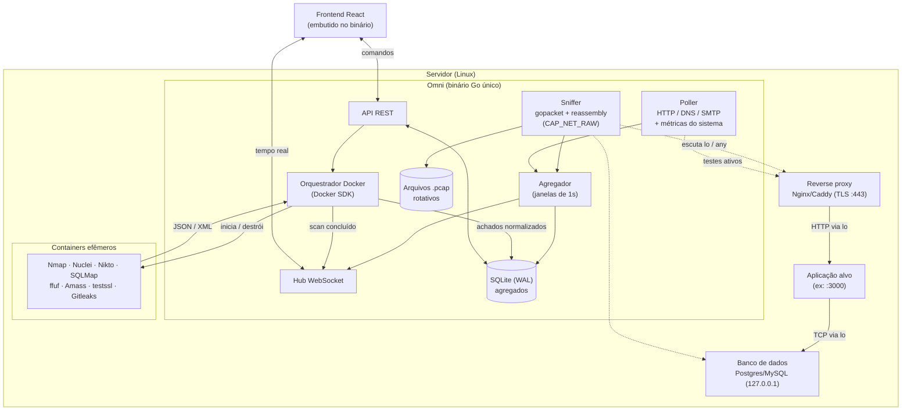

# Omni

Plataforma de **monitoramento e segurança** que roda **na mesma máquina do servidor** que observa. Ela une três visões em um único painel:

- **Monitoramento passivo:** captura de tráfego com gopacket, um "mini-Wireshark" embutido.
- **Monitoramento ativo:** testes periódicos de HTTP, DNS e SMTP, mais métricas do sistema.
- **Arsenal de segurança:** ferramentas como Nmap e Nuclei executadas em containers Docker efêmeros.

> **Status:** versão básica implementada. As Sprints 1 a 8 (núcleo, Poller, interface, sniffer das camadas 3 e 4, HTTP, PostgreSQL e Arsenal com Nmap, Nuclei e testssl) estão prontas; a Fase 4 (expansão) segue no backlog. Veja [docs/SPRINTS.md](docs/SPRINTS.md).

---

## Sumário

- [Visão geral](#visão-geral)
- [Arquitetura](#arquitetura)
- [Componentes](#componentes)
- [Fluxo de funcionamento](#fluxo-de-funcionamento)
- [Comunicação em tempo real (WebSocket)](#comunicação-em-tempo-real-websocket)
- [Interface (frontend)](#interface-frontend)
- [Alertas e notificação por e-mail](#alertas-e-notificação-por-e-mail)
- [Monitoramento de DNS e SMTP](#monitoramento-de-dns-e-smtp)
- [Requisitos de implantação](#requisitos-de-implantação)
- [O que falta implementar, por camada](#o-que-falta-implementar-por-camada)
- [Segurança da própria plataforma](#segurança-da-própria-plataforma)
- [Limitações conhecidas](#limitações-conhecidas)
- [Roadmap](#roadmap)
- [Stack](#stack)

---

## Visão geral

O Omni é distribuído como um **binário Go único**, com o frontend React embutido via `go:embed`, instalado no próprio servidor da aplicação monitorada. Como compartilha a máquina com a aplicação, o Omni enxerga:

- o tráfego que chega à aplicação, inclusive o HTTP em texto puro atrás do reverse proxy, na interface `lo`;
- as consultas que a aplicação faz ao banco, quando o banco está na mesma máquina e é acessado via TCP local;
- o consumo de recursos do servidor (CPU, RAM, disco, conexões).

## Arquitetura



## Componentes

| Componente | Responsabilidade |
|---|---|
| **Sniffer** | Captura nas interfaces `lo`/`any` com filtro BPF nas portas do alvo. Remonta fluxos TCP e decodifica HTTP, PostgreSQL, MySQL, DNS e SMTP. |
| **Poller** | Testes ativos periódicos: disponibilidade e latência HTTP, resolução DNS, handshake SMTP e STARTTLS, validade do certificado. Coleta CPU, RAM, disco e conexões via `gopsutil` e `/proc`. |
| **Orquestrador Docker** | Sobe containers efêmeros do arsenal com limites de CPU e RAM, coleta a saída, normaliza os achados num esquema único e destrói o container. |
| **Agregador** | Consolida eventos em janelas de 1s (requisições por rota, status HTTP, latência, consultas, banda, protocolos) e grava em lote. |
| **API REST** | CRUD de alvos, disparo e agendamento de scans, consultas ao histórico e geração de relatórios em PDF. |
| **Hub WebSocket** | Envia alertas, métricas e pacotes ao frontend em lotes, com buffer por cliente. |
| **Armazenamento** | SQLite em modo WAL, só com agregados e achados. Capturas completas ficam em arquivos `.pcap` rotativos. |

### Arsenal (containers)

| Ferramenta | Função |
|---|---|
| **Nmap** | Portas abertas e serviços |
| **Nuclei** | Vulnerabilidades conhecidas (CVEs) e más configurações, via templates |
| **Nikto** | Falhas em servidores web |
| **SQLMap** | Injeção de SQL |
| **ffuf** | Descoberta de diretórios e rotas ocultas |
| **Amass** | Descoberta de subdomínios do domínio da aplicação |
| **testssl.sh** | Validade do certificado e força da criptografia TLS |
| **Gitleaks / Trufflehog** | Vazamento de segredos no código |

## Fluxo de funcionamento

1. **Cadastro do alvo:** o usuário informa as portas da aplicação, a porta do banco e o domínio. O formulário sugere os serviços que já escutam portas TCP na máquina (aplicações e bancos, sem os serviços do sistema), e um clique preenche host e portas.
2. **Captura passiva:** o Sniffer aplica um filtro BPF nessas portas. A partir do tráfego gera métricas de requisições, status HTTP, latência, consultas ao banco, banda e protocolos.
3. **Testes ativos:** o Poller verifica periodicamente se a aplicação está no ar e respondendo bem, e coleta métricas do sistema.
4. **Agregação:** a cada segundo, o Agregador salva os agregados no SQLite e envia as atualizações em lote pelo WebSocket, e os gráficos se atualizam.
5. **Varredura de segurança:** sob demanda ou agendada, o Orquestrador roda as ferramentas selecionadas, consolida as vulnerabilidades, compara com o scan anterior e avisa o fim pelo WebSocket.
6. **Relatórios:** o usuário filtra o período e os módulos e exporta um PDF.

## Comunicação em tempo real (WebSocket)

- **Protocolo:** WebSocket puro com `gorilla/websocket` no Go e `react-use-websocket` no React. A reconexão automática fica a cargo da biblioteca do frontend.
- **Comandos** que alteram estado (criar alvo, iniciar scan) usam a API REST. O WebSocket transporta eventos e comandos leves do Inspetor (pausar captura, mudar filtro).
- **Cada cliente tem um canal com buffer próprio.** Se o cliente ficar lento, mensagens antigas são descartadas em vez de travar o hub.
- **Pacotes são enviados em lotes** (por exemplo, a cada 500 ms), nunca um a um.

**Conexão:** o cliente pede um ticket em `POST /api/ws/ticket`, com o token da API, e abre a conexão em `GET /ws?ticket=<ticket>`. O ticket vale por 30 s e só pode ser usado uma vez:

```bash
curl -s -X POST -H "Authorization: Bearer $OMNI_TOKEN" 127.0.0.1:8080/api/ws/ticket
# {"ticket":"..."}  →  ws://127.0.0.1:8080/ws?ticket=...
```

Toda mensagem vem no envelope `{ "tipo": ..., "dados": ... }`. Os eventos desta sprint:

```json
{ "tipo": "STATUS_ALVOS", "dados": { "resultados": [ { "alvo_id": 1, "porta": 3000, "tipo": "http", "no_ar": true, "status_http": 200, "latencia_ms": 1.2, "hora": "2026-11-20T17:31:46Z" } ] } }
{ "tipo": "ALERTA_QUEDA", "dados": { "alvo_id": 1, "alvo": "api", "porta": 3000, "erro": "dial tcp 127.0.0.1:3000: connect: connection refused", "hora": "2026-11-20T17:31:52Z" } }
{ "tipo": "SERVICO_RESTAURADO", "dados": { "alvo_id": 1, "alvo": "api", "porta": 3000, "hora": "2026-11-20T17:31:56Z" } }
{ "tipo": "METRICAS_SISTEMA", "dados": { "cpu": 10.9, "memoria": 50.2, "disco": 4.7, "hora": "2026-11-20T17:31:49Z" } }
{ "tipo": "METRICAS_TRAFEGO", "dados": { "inicio": "2026-11-21T12:00:00Z", "bytes": 48210, "pacotes": 61, "descartados": 0, "protocolos": { "HTTP": 40100, "PostgreSQL": 8110 }, "top_origens": [ { "ip": "127.0.0.1", "bytes": 30020, "pacotes": 33 } ] } }
{ "tipo": "ESTADO_MOTORES", "dados": { "sniffer": "ativo" } }
{ "tipo": "METRICAS_HTTP", "dados": { "inicio": "2026-11-21T12:00:00Z", "requisicoes": 42, "status": { "2xx": 40, "5xx": 2 }, "p50_ms": 1.4, "p95_ms": 12.8, "rotas": [ { "metodo": "GET", "rota": "/users/:id", "requisicoes": 30, "erros": 0, "p50_ms": 1.2, "p95_ms": 3.1 } ] } }
{ "tipo": "METRICAS_BANCO", "dados": { "inicio": "2026-11-21T12:00:00Z", "consultas": 18, "erros": 1, "tipos": { "SELECT": 15, "UPDATE": 3 }, "p50_ms": 0.6, "p95_ms": 4.2, "top": [ { "consulta": "SELECT * FROM u WHERE id = ?", "tipo": "SELECT", "execucoes": 15, "erros": 0, "p50_ms": 0.5, "p95_ms": 1.1 } ] } }
{ "tipo": "ESTADO_MOTORES", "dados": { "docker": "ativo" } }
{ "tipo": "SCAN_INICIADO", "dados": { "scan_id": 3, "alvo_id": 1, "ferramentas": ["nmap"] } }
{ "tipo": "SCAN_LOG", "dados": { "scan_id": 3, "ferramenta": "nmap", "linhas": ["Starting Nmap 7.95"] } }
{ "tipo": "SCAN_CONCLUIDO", "dados": { "scan_id": 3, "alvo_id": 1, "ferramentas": ["nmap"], "achados": 2, "novos_desde_ultimo": 1 } }
{ "tipo": "SCAN_FALHOU", "dados": { "scan_id": 4, "alvo_id": 1, "erro": "nmap: a ferramenta terminou com código 1", "achados": 0 } }
```

- `STATUS_ALVOS` sai a cada rodada do poller (`OMNI_INTERVALO_POLLER`, padrão 30 s, mínimo 1 s), com uma verificação por porta: HTTP nas portas da aplicação e TCP na porta do banco.
- `ALERTA_QUEDA` e `SERVICO_RESTAURADO` saem só na mudança de estado de uma porta.
- `METRICAS_SISTEMA` sai a cada 5 s, com CPU, memória e disco (do volume do banco) em porcentagem.
- O histórico das verificações das últimas 24 h fica em `GET /api/alvos/{id}/historico` (aceita `?desde=<RFC3339>`).
- `METRICAS_TRAFEGO` sai a cada segundo enquanto o sniffer captura: bytes, pacotes, bytes por protocolo, os dez IPs de origem com mais tráfego e os pacotes que o pcap descartou (`descartados` maior que zero indica métricas incompletas). O protocolo é deduzido pela porta; as portas da aplicação contam como HTTP.
- `ESTADO_MOTORES` sai a cada 5 s e a cada mudança, com o estado do sniffer: `ativo`, `inativo` (sem alvos cadastrados) ou `sem-permissao` (falta `CAP_NET_RAW`; o resto do Omni segue no ar).
- As janelas com tráfego ficam 24 h no banco e saem em `GET /api/trafego` (últimos 15 minutos; aceita `?desde=<RFC3339>`, até 3600 janelas).
- `METRICAS_HTTP` sai a cada 10 s: o sniffer remonta os fluxos TCP das portas da aplicação (`gopacket/reassembly`, até 4 MiB em buffer por conexão, fluxos ociosos fechados em 2 min), pareia requisição e resposta (inclusive em pipeline e fora de ordem) e agrega contagem, classes de status e latência p50/p95 por rota normalizada (`/users/123` vira `/users/:id`). Cabeçalhos, query strings e corpos nunca são guardados, e o tráfego com User-Agent `Omni-` (Poller e Arsenal) fica fora. Rotas: `GET /api/requisicoes` (janelas, últimos 15 minutos) e `GET /api/requisicoes/rotas` (as 100 rotas de mais volume das últimas 24 h).
- `METRICAS_BANCO` sai a cada 10 s com as consultas ao PostgreSQL na porta do banco dos alvos (consultas simples e Parse/Bind/Execute, com erros). O SQL é normalizado: literais viram `?`, comentários somem e listas viram `(?)`. Mensagens de senha nunca são lidas, e conexões com TLS são ignoradas. Rotas: `GET /api/consultas` e `GET /api/consultas/lentas?limite=` (padrão 20, as de maior p95 em 24 h). As métricas HTTP e de banco ficam 24 h no banco, como as de tráfego.
- O Docker informa o estado no `ESTADO_MOTORES` a cada 5 s: `ativo` ou `indisponivel`.
- `ALERTA` sai quando uma métrica muda de nível (verde, amarelo ou vermelho); veja [Alertas e notificação por e-mail](#alertas-e-notificação-por-e-mail).
- `SCAN_LOG` leva a saída da ferramenta em lotes a cada 500 ms (no máximo 20 000 linhas por ferramenta); `SCAN_CONCLUIDO` traz quantos achados são novos em relação à varredura anterior.

## Interface (frontend)

**Como rodar:** `make build` compila a interface (em `web/`) e gera o binário `./omni` com ela embutida; basta abrir `http://127.0.0.1:8080` e informar o token. Para desenvolver a interface com recarga automática, rode o backend num terminal e o Vite noutro, e abra `http://localhost:5173`:

```bash
OMNI_DEV=1 OMNI_TOKEN=<token> go run ./cmd/omni
```

```bash
cd web && npm run dev
```

**Barra superior:** seletor global de alvo, estado dos motores (Sniffer, Poller, Docker) e notificações.

**Barra lateral:**

- **Monitoramento:** Geral, Requisições na API, Consultas no banco, Status HTTP, Sistema
- **Tráfego:** Inspetor de pacotes, Capturas (`.pcap`)
- **Arsenal:** Nmap, Nuclei, Nikto, SQLMap, ffuf, Amass, testssl, Vazamentos
- **Relatórios:** histórico, comparação entre scans, exportação em PDF

**Tela Geral:**

- Gráfico de requisições na API
- Gráfico de consultas no banco
- Barras empilhadas de status HTTP (2xx, 3xx, 4xx, 5xx)
- Consumo de banda
- Distribuição de protocolos
- Logs de **eventos agregados**, como quedas, início e fim de scans e picos de erro

O detalhe pacote a pacote fica **apenas no Inspetor de Tráfego**, que usa uma tabela virtualizada (TanStack Table) com botão de pausa. Colocá-lo na tela Geral travaria o navegador.

As telas laterais de métricas são **drill-down**: mostram o gráfico e, abaixo dele, uma tabela detalhada, por exemplo as consultas mais lentas das últimas 24 horas.

## Alertas e notificação por e-mail

O motor de alertas (`internal/alerts`) observa os mesmos eventos que o frontend recebe (`STATUS_ALVOS`, `METRICAS_HTTP`, `METRICAS_BANCO` e `METRICAS_SISTEMA`), compara cada métrica com dois limites e classifica o recurso em três níveis:

| Nível | Significado | Ação |
|---|---|---|
| 🟢 Verde | Estado normal | Nenhuma; a volta ao verde gera um e-mail de normalização |
| 🟡 Amarelo | Degradação que exige observação | E-mail |
| 🔴 Vermelho | Serviço degradado ou indisponível | E-mail imediato |

Um nível só muda depois que a condição se mantém pelo tempo da regra (coluna "Por"), para que um pico isolado não vire alerta. Queda de porta não espera: vira vermelho na primeira verificação que falha.

| Regra | Serviço | Amarelo a partir de | Vermelho a partir de | Por |
|---|---|---|---|---|
| Disponibilidade (por porta) | Web / Banco / DNS / SMTP | respondeu com erro (HTTP 5xx, RCODE de erro, comando SMTP recusado) | não respondeu | imediato |
| Latência da verificação ativa | Web / Banco | 1000 ms | 3000 ms | 1 min |
| Taxa de erros 5xx | Web | 10% | 25% | 30 s |
| Latência p95 das requisições | Web | 1000 ms | 2500 ms | 30 s |
| Taxa de erros nas consultas | Banco | 10% | 25% | 30 s |
| Latência p95 das consultas | Banco | 500 ms | 2000 ms | 30 s |
| Tempo de resolução DNS | DNS | 200 ms | 1000 ms | 30 s |
| Latência da conversa SMTP | SMTP | 2000 ms | 5000 ms | 30 s |
| Taxa de falhas da sonda (últimas 10, mínimo 5) | DNS / SMTP | 20% | 50% | imediato |
| SMTP sem STARTTLS | SMTP | servidor não oferece STARTTLS | — | imediato |
| Uso de CPU / memória / disco | Sistema | 80% / 85% / 85% | 95% | 1 min |

As taxas e o p95 só contam com pelo menos 20 requisições ou consultas na janela de 10 s, para uma única falha não virar "50% de erro". Cada mudança de nível sai no WebSocket como `ALERTA`, aparece na tela **Alertas** (`/alertas`) e em `GET /api/alertas` (nível atual por recurso, últimas 200 mudanças, regras e estado do e-mail):

```json
{ "tipo": "ALERTA", "dados": { "id": 3, "regra": "http_p95", "servico": "web", "nome": "Latência p95 das requisições", "recurso": "", "nivel": "amarelo", "nivel_anterior": "verde", "valor": 1234.5, "limite": 1000, "unidade": "ms", "hora": "2026-11-21T20:10:00Z" } }
```

### Configurar o e-mail

Sem `OMNI_SMTP_HOST` o envio fica desligado e o restante funciona normalmente.

| Variável | Uso |
|---|---|
| `OMNI_SMTP_HOST` | Servidor SMTP. Liga o envio |
| `OMNI_SMTP_PORTA` | Padrão 587 (STARTTLS). Na 465 o TLS começa já na conexão |
| `OMNI_SMTP_USUARIO` | Usuário do SMTP (opcional) |
| `OMNI_SMTP_SENHA` ou `OMNI_SMTP_SENHA_ARQUIVO` | Senha, ou caminho de um arquivo com ela (preferível: variáveis de ambiente ficam visíveis em `/proc/<pid>/environ`) |
| `OMNI_SMTP_REMETENTE` | Endereço que envia; se vazio, usa o usuário quando ele é um e-mail |
| `OMNI_ALERTA_EMAILS` | Destinatários, separados por vírgula |

**Teste local sem conta de e-mail,** com o [Mailpit](https://mailpit.axllent.org/), que captura as mensagens e as mostra numa página:

```bash
docker run -d --name mailpit -p 127.0.0.1:1025:1025 -p 127.0.0.1:8025:8025 axllent/mailpit
OMNI_TOKEN=... OMNI_SMTP_HOST=127.0.0.1 OMNI_SMTP_PORTA=1025 \
  OMNI_SMTP_REMETENTE=omni@localhost OMNI_ALERTA_EMAILS=equipe@exemplo.com ./omni
# derrube a loja cobaia e abra http://127.0.0.1:8025
```

**Gmail:** `OMNI_SMTP_HOST=smtp.gmail.com`, porta 587, o seu endereço como usuário e uma [senha de app](https://support.google.com/accounts/answer/185833) (exige verificação em duas etapas) no lugar da senha da conta.

**Proteções do envio:**

- **TLS obrigatório para a senha.** Se o servidor não oferece STARTTLS, o Omni se recusa a autenticar, exceto em servidor local (`127.0.0.1`/`localhost`).
- **Sem injeção de cabeçalho.** Quebras de linha são removidas dos campos que vêm do usuário (como o nome do alvo), e os endereços são validados na inicialização: um nome como `x\r\nBcc: alguem@exemplo.com` não cria cópias ocultas.
- **Limite de 20 e-mails por minuto.** Um ataque que derruba o serviço não vira, de quebra, uma enxurrada de e-mails; o e-mail seguinte informa quantos alertas foram suprimidos.
- **Envio fora do caminho crítico.** Os e-mails saem de uma fila numa goroutine própria: um SMTP lento ou fora do ar nunca atrasa o Poller, o sniffer ou o WebSocket.

## Monitoramento de DNS e SMTP

Cada alvo pode ter uma **porta DNS** e uma **porta SMTP** (campos `porta_dns` e `porta_smtp`), no mesmo host do alvo. O Poller testa as duas a cada rodada, junto com as portas da aplicação, e o resultado sai no `STATUS_ALVOS` com `tipo` `dns` ou `smtp`:

```json
{ "alvo_id": 1, "porta": 1053, "tipo": "dns", "no_ar": true, "degradado": true, "detalhe": "NXDOMAIN", "latencia_ms": 0.8, "hora": "..." }
{ "alvo_id": 1, "porta": 1025, "tipo": "smtp", "no_ar": true, "starttls": false, "detalhe": "aceita destinatário postmaster", "latencia_ms": 3.1, "hora": "..." }
```

**Sonda DNS** (`internal/probe/dns.go`): um cliente DNS feito só com a biblioteca padrão, que monta o pacote byte a byte (RFC 1035). Pergunta pelo registro A do **domínio** do alvo (obrigatório quando há porta DNS) e mede o tempo de resolução. Responder com qualquer código conta como "no ar"; `NXDOMAIN`, `SERVFAIL`, `REFUSED` ou uma resposta sem endereços contam como degradado (amarelo). Respostas truncadas (bit TC) são repetidas por TCP. Por segurança, a sonda:

- usa um ID de consulta aleatório (a porta de origem também é aleatória) e descarta respostas com ID diferente ou para outro nome, a defesa básica contra envenenamento de cache (ataque de Kaminsky);
- limita os saltos de ponteiros de compressão, para um pacote malicioso com ponteiros em ciclo não travar a leitura.

**Sonda SMTP** (`internal/probe/smtp.go`): conversa com o servidor **sem enviar e-mail**: espera a saudação `220`, manda `EHLO` e anota se o servidor oferece `STARTTLS`. Com domínio no alvo, testa também `MAIL FROM:<>` e `RCPT TO:<postmaster@domínio>` e desfaz com `RSET`; todo domínio que recebe e-mail precisa aceitar `postmaster` (RFC 5321, seção 4.5.1). Um comando recusado (4xx/5xx) é degradado; conexão recusada, timeout ou saudação diferente de 220 é fora do ar. Servidor sem STARTTLS gera o alerta amarelo "SMTP sem STARTTLS": os e-mails trafegariam em texto puro.

A taxa de falhas usa as últimas 10 verificações de cada porta (precisa de pelo menos 5). Com o intervalo padrão de 30 s, isso cobre os últimos 5 minutos.

**Ambiente de teste** em `exemplos/dns-smtp/`: um CoreDNS que resolve `loja.local` na porta 1053 e um Mailpit na porta 1025.

```bash
cd exemplos/dns-smtp && docker compose up -d
dig @127.0.0.1 -p 1053 loja.local +short        # 127.0.0.1
```

Cadastre (ou edite) o alvo com domínio `loja.local`, porta DNS `1053` e porta SMTP `1025`. Para ver os níveis mudarem:

- **Amarelo no DNS:** troque o domínio para `nao-existe.loja.local` (NXDOMAIN).
- **Vermelho no DNS ou SMTP:** `docker compose stop coredns` ou `docker compose stop mailpit`.
- **Amarelo "SMTP sem STARTTLS":** já aparece com o Mailpit padrão, que não tem TLS.

**Ainda não coberto:** consultas por segundo do DNS, volume e fila do SMTP. Essas métricas dependem do tráfego real e entram com a captura passiva no sniffer (UDP 53 e SMTP).

## Requisitos de implantação

- **Sistema:** servidor Linux. No Windows, rode o Omni dentro do WSL2 (veja [Windows](#windows)).
- **Reverse proxy terminando o TLS** e repassando à aplicação via `localhost`. Sem isso, o tráfego HTTPS fica ilegível para o Sniffer.
- **Banco acessado via TCP em `127.0.0.1`,** e não por unix socket, que o pcap não enxerga.
- **libpcap:** a captura ao vivo usa cgo e precisa do `libpcap-dev` (Debian/Ubuntu) ou `libpcap` (Arch) para compilar. Um binário compilado com `CGO_ENABLED=0` roda, mas com o sniffer sempre inativo.
- **Privilégios mínimos:** a captura usa só `CAP_NET_RAW` e `CAP_NET_ADMIN`, sem root. Refaça depois de cada build, porque o binário novo perde as capabilities:
  ```bash
  sudo setcap cap_net_raw,cap_net_admin=eip ./omni
  ```
- **Interface de captura:** `OMNI_INTERFACE` (padrão `any`, que inclui o loopback). O filtro BPF cobre as portas TCP de todos os alvos e é refeito quando os alvos mudam.
- **Docker** instalado, só para o Arsenal. O Omni fala com a API do Docker Engine pelo socket Unix (`/var/run/docker.sock` ou `DOCKER_HOST=unix://...`), então o usuário que roda o Omni precisa de acesso a ele. Os containers rodam com `network_mode: host`, 1 CPU e 512 MiB; o Nuclei recebe 1,5 GiB, porque carregar os templates passa de 512 MiB. Os templates do Nuclei ficam no volume `omni-nuclei-templates` e são baixados na primeira varredura.

**Arsenal pela API:** `GET /api/ferramentas` lista as ferramentas; `POST /api/varreduras` com `{"alvo_id": 1, "ferramentas": ["nmap", "nuclei", "testssl"]}` responde 202 `{"id": ...}` e roda em segundo plano (400 para ferramenta desconhecida ou alvo fora do escopo, 409 se o alvo já tem varredura em andamento, 503 com o Docker parado). `GET /api/varreduras?alvo_id=`, `GET /api/varreduras/{id}`, `GET /api/varreduras/{id}/achados` e `GET /api/varreduras/{id}/comparacao` (novos e resolvidos em relação à varredura concluída anterior de cada ferramenta) completam o fluxo. Varreduras interrompidas pelo desligamento do Omni ficam como `falhou`.

### Windows

O Omni não roda completo direto no Windows. O binário compila e a interface abre, mas dois motores ficam desligados:

| Motor | No Windows nativo | Motivo |
|---|---|---|
| Poller | Funciona | Só faz conexões TCP e requisições HTTP |
| Sniffer | Inativo | A interface padrão `any` não existe no Npcap, e `OMNI_INTERFACE` só aceita nomes no estilo Linux (até 15 caracteres), o que recusa os nomes do Npcap (`\Device\NPF_...`) |
| Arsenal (Docker) | Indisponível | O Omni só fala com o Docker por socket Unix (`unix://`), e o Docker Desktop atende no Windows por named pipe (`npipe://`) |

**Caminho recomendado: WSL2.** O Omni roda dentro de uma distribuição Linux do WSL2, e a interface é aberta pelo navegador do Windows em `http://localhost:8080`, porque o WSL2 repassa as portas do loopback para o Windows. Dentro do WSL, o Omni se comporta como num servidor Linux: siga os requisitos acima (`libpcap-dev`, `setcap`, Docker pelo socket Unix).

Cuidados no WSL2:

- **Use o Docker Engine instalado na própria distribuição**, e não a integração do Docker Desktop. Com a integração, o comando `docker` da distribuição fala com o motor do Docker Desktop, que roda em outra máquina virtual: containers com `network_mode: host` ficam no loopback dessa outra máquina, fora do alcance da aplicação e do Sniffer. Desligue a integração em *Settings → Resources → WSL integration* e instale o Docker Engine pelo repositório oficial da distribuição.
- **O Sniffer só enxerga o tráfego de dentro do WSL.** Aplicações rodando no Windows podem ser vigiadas pelo Poller e varridas pelo Arsenal, mas o tráfego delas não passa pela interface do WSL.
- **O `setcap` não funciona em `/mnt/c`.** Compile o binário para o sistema de arquivos do Linux (por exemplo, `go build -o ~/omni-bin/omni ./cmd/omni`) e aplique as capabilities nele.
- **Guarde o banco do Omni no sistema de arquivos do Linux** (`OMNI_DB=~/omni.db`): o SQLite em `/mnt/c` pode ter problemas de trava de arquivo.

## O que falta implementar, por camada

### Camada 7: Aplicação

- [ ] **Decodificador HTTP/1.1:** método, rota, status e latência por requisição.
- [ ] **Decodificador HTTP/2:** protocolo binário, usado pela maioria dos proxies modernos.
- [ ] **Normalização de rotas:** agrupar `/users/123` e `/users/456` como `/users/:id`.
- [ ] **Decodificador PostgreSQL:** mensagens `Query` e `Parse`, com pareamento entre consulta e resposta para medir o tempo.
- [ ] **Decodificador MySQL:** `COM_QUERY`, com o mesmo pareamento.
- [ ] **Complemento opcional para PostgreSQL:** coletar estatísticas de `pg_stat_statements`.
- [ ] **DNS:** latência, taxa de NXDOMAIN, registros MX e TXT (SPF/DKIM) e respostas inesperadas.
- [ ] **SMTP:** tempo do handshake (`220`), suporte a STARTTLS e volume de envios.
- [ ] **Mascaramento de dados sensíveis** (`Authorization`, `Cookie`, senhas) antes de qualquer gravação.
- [ ] **Parsers do Arsenal** com um esquema único de achado (alvo, ferramenta, severidade, evidência), severidade normalizada (CVSS) e deduplicação entre ferramentas.
- [ ] **Comparação entre scans:** indicar o que mudou desde o anterior, por exemplo "porta 22 abriu desde ontem".
- [ ] **Agendamento de scans** e alertas externos (Telegram, Discord, e-mail).

### Camada 6: Apresentação (TLS)

- [ ] **Captura após o reverse proxy** (`lo`) para ler o HTTP em texto puro.
- [ ] **Metadados do handshake TLS,** visíveis mesmo com criptografia: SNI, versão, cifra e validade do certificado.
- [ ] **Alternativa sem proxy, mais complexa:** eBPF em `SSL_read`/`SSL_write`.

### Camada 4: Transporte

- [ ] **Remontagem TCP** com `gopacket/reassembly` (o `tcpassembly` está obsoleto), com limite de memória por fluxo e timeout para conexões abandonadas.
- [ ] **RTT** medido pelo par SYN → SYN-ACK.
- [ ] **Retransmissões e pacotes fora de ordem,** que indicam rede degradada.
- [ ] **RST em excesso** (serviço recusando conexões) e **SYN sem resposta** (possível SYN flood ou varredura).
- [ ] **Janela TCP zero,** sinal de que a aplicação não está dando conta.
- [ ] **Conexões por estado** (ESTABLISHED, TIME_WAIT) via `/proc/net/tcp`, cruzadas com o processo dono da porta.
- [ ] **UDP:** volume por porta e detecção de amplificação (resposta muito maior que a requisição).

### Camada 3: Rede

- [ ] **Top IPs de origem por número de conexões,** para detectar abuso ou DDoS (o volume em bytes já aparece na tela Geral).
- [ ] **ICMP:** destino inalcançável e TTL excedido.
- [ ] **Fragmentação IP.**
- [ ] **Suporte completo a IPv6.**
- [ ] **GeoIP opcional** (MaxMind GeoLite) para mapear a origem do tráfego.

### Camada 2: Enlace

- [ ] **Detecção de ARP spoofing:** o mesmo IP anunciado com MACs diferentes.
- [ ] **Interfaces virtuais** (`docker0`, `veth*`, bridges) quando a aplicação roda em containers.

### Camada 1 e sistema

- [ ] **Contadores da placa** (`/sys/class/net/*/statistics`): erros, descartes e utilização do link.
- [ ] **Captura de alto desempenho:** AF_PACKET com ring buffer e `DecodingLayerParser`, para não sobrecarregar o garbage collector.
- [ ] **Limites de CPU e RAM** para o Omni e os containers, para não derrubar a produção.

## Segurança da própria plataforma

O Omni roda no servidor de produção, com acesso ao Docker e privilégio de captura. **Se ele for comprometido, o servidor inteiro é comprometido.** Por isso:

- **A API e o WebSocket escutam apenas em `127.0.0.1`.** O acesso remoto é feito por túnel SSH:
  ```bash
  ssh -L 8080:127.0.0.1:8080 usuario@servidor
  ```
- **Autenticação obrigatória** por token, mesmo em acesso local.
- **Verificação de origem no WebSocket** (`CheckOrigin`), contra sequestro de WebSocket entre sites (CSWSH). Acesso por túnel numa porta local diferente de 8080 exige a origem em `OMNI_ORIGENS` (ex.: `OMNI_ORIGENS=http://localhost:9999`). Com `OMNI_DEV=1`, as origens do Vite (porta 5173) também são liberadas.
- **Descoberta de serviços sem segredos:** `GET /api/descoberta` exige o token e devolve só nome do processo, PID, host e portas, nunca a linha de comando, que costuma conter senhas. Sem root, processos de outros usuários aparecem sem nome.
- **Validação estrita do alvo** (IP, domínio ou porta), com argumentos passados aos containers **como array, nunca como string concatenada**, para evitar injeção de comando.
- **Escopo travado:** o Arsenal só roda contra `localhost` e os domínios cadastrados da aplicação.
- **Imagens Docker com versão fixa,** de preferência oficiais ou construídas pelo próprio projeto: `instrumentisto/nmap:7.95`, `projectdiscovery/nuclei:v3.4.10` e `drwetter/testssl.sh:3.2`.
- **Retenção de dados configurável,** já que capturas podem conter dados pessoais (LGPD).

## Limitações conhecidas

- **Scans locais não representam a visão de um atacante externo.** Eles enxergam portas ligadas só a `127.0.0.1` e ignoram firewall e security groups da nuvem. Por isso aparecem rotulados como "visão interna".
- **O tráfego gerado pelos próprios scans** precisa ser marcado e filtrado das métricas, pela origem ou por um User-Agent próprio. Sem isso, os gráficos de requisições e de status HTTP ficam poluídos.
- **Aplicações que usam SQLite como banco** não geram tráfego de rede, então não há gráfico de consultas para elas.
- **Traceroute** só faz sentido para destinos externos ao servidor.
- **Windows nativo** roda só com o Poller: o Sniffer e o Arsenal ficam desligados. Use o WSL2 (veja [Windows](#windows)).

## Roadmap

A implementação está dividida em **4 fases e 8 sprints**, e cada sprint entrega uma versão funcional que serve de base para a seguinte:

| Fase | Sprints |
|---|---|
| 1. Fundação | 1. Núcleo do backend · 2. Poller e WebSocket · 3. Frontend base |
| 2. Observação passiva | 4. Sniffer (camadas 3 e 4) · 5. HTTP · 6. PostgreSQL |
| 3. Arsenal | 7. Orquestrador Docker e Nmap · 8. Nuclei, testssl e comparação entre scans |
| 4. Expansão | Backlog com o restante das pendências por camada |

**➡️ O que é feito em cada sprint, com entregas e status: [docs/SPRINTS.md](docs/SPRINTS.md)**

O plano técnico detalhado (arquivos, interfaces e testes de cada tarefa) fica em [docs/superpowers/plans/2026-11-18-implementacao-basica.md](docs/superpowers/plans/2026-11-18-implementacao-basica.md).

## Stack

| Camada | Tecnologias |
|---|---|
| **Backend** | Go, `gopacket/gopacket` (fork mantido), `gopacket/reassembly`, Docker SDK, `gorilla/websocket`, `gopsutil`, SQLite |
| **Frontend** | React + TypeScript, Tailwind CSS + shadcn/ui, Zustand, TanStack Table, Recharts ou Apache ECharts, `react-use-websocket` |
| **Arsenal** | Nmap, Nuclei, Nikto, SQLMap, ffuf, Amass, testssl.sh, Gitleaks |
