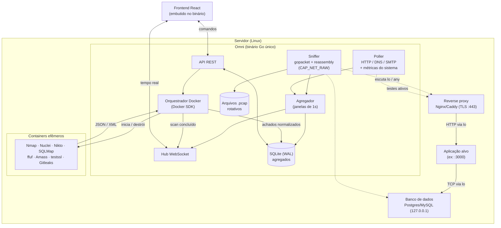

# Omni

Plataforma de **monitoramento e segurança** que roda **na mesma máquina do servidor** que observa. Ela une três visões em um único painel:

- **Monitoramento passivo:** captura de tráfego com gopacket, um "mini-Wireshark" embutido.
- **Monitoramento ativo:** testes periódicos de HTTP, DNS e SMTP, mais métricas do sistema.
- **Arsenal de segurança:** ferramentas como Nmap e Nuclei executadas em containers Docker efêmeros.

> **Status:** em fase de especificação. Ainda não há código implementado.

---

## Sumário

- [Visão geral](#visão-geral)
- [Arquitetura](#arquitetura)
- [Componentes](#componentes)
- [Fluxo de funcionamento](#fluxo-de-funcionamento)
- [Comunicação em tempo real (WebSocket)](#comunicação-em-tempo-real-websocket)
- [Interface (frontend)](#interface-frontend)
- [Requisitos de implantação](#requisitos-de-implantação)
- [O que falta implementar, por camada](#o-que-falta-implementar-por-camada)
- [Segurança da própria plataforma](#segurança-da-própria-plataforma)
- [Limitações conhecidas](#limitações-conhecidas)
- [Roadmap](#roadmap)
- [Stack](#stack)

---

## Visão geral

O Omni é distribuído como um **binário Go único**, com o frontend React embutido via `go:embed`, instalado no próprio servidor da aplicação monitorada. Como compartilha a máquina com a aplicação, o Omni enxerga:

- o tráfego que chega à aplicação, inclusive o HTTP em texto puro atrás do reverse proxy, na interface `lo`;
- as consultas que a aplicação faz ao banco, quando o banco está na mesma máquina e é acessado via TCP local;
- o consumo de recursos do servidor (CPU, RAM, disco, conexões).

## Arquitetura



## Componentes

| Componente | Responsabilidade |
|---|---|
| **Sniffer** | Captura nas interfaces `lo`/`any` com filtro BPF nas portas do alvo. Remonta fluxos TCP e decodifica HTTP, PostgreSQL, MySQL, DNS e SMTP. |
| **Poller** | Testes ativos periódicos: disponibilidade e latência HTTP, resolução DNS, handshake SMTP e STARTTLS, validade do certificado. Coleta CPU, RAM, disco e conexões via `gopsutil` e `/proc`. |
| **Orquestrador Docker** | Sobe containers efêmeros do arsenal com limites de CPU e RAM, coleta a saída, normaliza os achados num esquema único e destrói o container. |
| **Agregador** | Consolida eventos em janelas de 1s (requisições por rota, status HTTP, latência, consultas, banda, protocolos) e grava em lote. |
| **API REST** | CRUD de alvos, disparo e agendamento de scans, consultas ao histórico e geração de relatórios em PDF. |
| **Hub WebSocket** | Envia alertas, métricas e pacotes ao frontend em lotes, com buffer por cliente. |
| **Armazenamento** | SQLite em modo WAL, só com agregados e achados. Capturas completas ficam em arquivos `.pcap` rotativos. |

### Arsenal (containers)

| Ferramenta | Função |
|---|---|
| **Nmap** | Portas abertas e serviços |
| **Nuclei** | Vulnerabilidades conhecidas (CVEs) e más configurações, via templates |
| **Nikto** | Falhas em servidores web |
| **SQLMap** | Injeção de SQL |
| **ffuf** | Descoberta de diretórios e rotas ocultas |
| **Amass** | Descoberta de subdomínios do domínio da aplicação |
| **testssl.sh** | Validade do certificado e força da criptografia TLS |
| **Gitleaks / Trufflehog** | Vazamento de segredos no código |

## Fluxo de funcionamento

1. **Cadastro do alvo:** o usuário informa as portas da aplicação, a porta do banco e o domínio.
2. **Captura passiva:** o Sniffer aplica um filtro BPF nessas portas. A partir do tráfego gera métricas de requisições, status HTTP, latência, consultas ao banco, banda e protocolos.
3. **Testes ativos:** o Poller verifica periodicamente se a aplicação está no ar e respondendo bem, e coleta métricas do sistema.
4. **Agregação:** a cada segundo, o Agregador salva os agregados no SQLite e envia as atualizações em lote pelo WebSocket, e os gráficos se atualizam.
5. **Varredura de segurança:** sob demanda ou agendada, o Orquestrador roda as ferramentas selecionadas, consolida as vulnerabilidades, compara com o scan anterior e avisa o fim pelo WebSocket.
6. **Relatórios:** o usuário filtra o período e os módulos e exporta um PDF.

## Comunicação em tempo real (WebSocket)

- **Protocolo:** WebSocket puro com `gorilla/websocket` no Go e `react-use-websocket` no React. A reconexão automática fica a cargo da biblioteca do frontend.
- **Comandos** que alteram estado (criar alvo, iniciar scan) usam a API REST. O WebSocket transporta eventos e comandos leves do Inspetor (pausar captura, mudar filtro).
- **Cada cliente tem um canal com buffer próprio.** Se o cliente ficar lento, mensagens antigas são descartadas em vez de travar o hub.
- **Pacotes são enviados em lotes** (por exemplo, a cada 500 ms), nunca um a um.

Exemplos de mensagens:

```json
{ "tipo": "ALERTA_QUEDA", "alvo": "api", "servico": "PostgreSQL", "hora": "14:00:00" }
{ "tipo": "METRICAS", "janela": "14:00:01", "req_s": 120, "status": { "2xx": 115, "4xx": 4, "5xx": 1 } }
{ "tipo": "PACOTES", "lote": [ { "origem": "203.0.113.10", "destino": "127.0.0.1:3000", "proto": "HTTP", "tamanho": 512 } ] }
{ "tipo": "SCAN_CONCLUIDO", "ferramenta": "nmap", "achados": 3, "novos_desde_ultimo": 1 }
```

## Interface (frontend)

**Barra superior:** seletor global de alvo, estado dos motores (Sniffer, Poller, Docker) e notificações.

**Barra lateral:**

- **Monitoramento:** Geral, Requisições na API, Consultas no banco, Status HTTP, Sistema
- **Tráfego:** Inspetor de pacotes, Capturas (`.pcap`)
- **Arsenal:** Nmap, Nuclei, Nikto, SQLMap, ffuf, Amass, testssl, Vazamentos
- **Relatórios:** histórico, comparação entre scans, exportação em PDF

**Tela Geral:**

- Gráfico de requisições na API
- Gráfico de consultas no banco
- Barras empilhadas de status HTTP (2xx, 3xx, 4xx, 5xx)
- Consumo de banda
- Distribuição de protocolos
- Logs de **eventos agregados**, como quedas, início e fim de scans e picos de erro

O detalhe pacote a pacote fica **apenas no Inspetor de Tráfego**, que usa uma tabela virtualizada (TanStack Table) com botão de pausa. Colocá-lo na tela Geral travaria o navegador.

As telas laterais de métricas são **drill-down**: mostram o gráfico e, abaixo dele, uma tabela detalhada, por exemplo as consultas mais lentas das últimas 24 horas.

## Requisitos de implantação

- **Sistema:** servidor Linux. O Windows funciona com Npcap, mas não é o alvo principal.
- **Reverse proxy terminando o TLS** e repassando à aplicação via `localhost`. Sem isso, o tráfego HTTPS fica ilegível para o Sniffer.
- **Banco acessado via TCP em `127.0.0.1`,** e não por unix socket, que o pcap não enxerga.
- **Privilégios mínimos:** a captura usa só `CAP_NET_RAW` e `CAP_NET_ADMIN`, sem root:
  ```bash
  sudo setcap cap_net_raw,cap_net_admin=eip ./omni
  ```
- **Docker** instalado, só para o Arsenal. Os containers rodam com `network_mode: host`.

## O que falta implementar, por camada

### Camada 7: Aplicação

- [ ] **Decodificador HTTP/1.1:** método, rota, status e latência por requisição.
- [ ] **Decodificador HTTP/2:** protocolo binário, usado pela maioria dos proxies modernos.
- [ ] **Normalização de rotas:** agrupar `/users/123` e `/users/456` como `/users/:id`.
- [ ] **Decodificador PostgreSQL:** mensagens `Query` e `Parse`, com pareamento entre consulta e resposta para medir o tempo.
- [ ] **Decodificador MySQL:** `COM_QUERY`, com o mesmo pareamento.
- [ ] **Complemento opcional para PostgreSQL:** coletar estatísticas de `pg_stat_statements`.
- [ ] **DNS:** latência, taxa de NXDOMAIN, registros MX e TXT (SPF/DKIM) e respostas inesperadas.
- [ ] **SMTP:** tempo do handshake (`220`), suporte a STARTTLS e volume de envios.
- [ ] **Mascaramento de dados sensíveis** (`Authorization`, `Cookie`, senhas) antes de qualquer gravação.
- [ ] **Parsers do Arsenal** com um esquema único de achado (alvo, ferramenta, severidade, evidência), severidade normalizada (CVSS) e deduplicação entre ferramentas.
- [ ] **Comparação entre scans:** indicar o que mudou desde o anterior, por exemplo "porta 22 abriu desde ontem".
- [ ] **Agendamento de scans** e alertas externos (Telegram, Discord, e-mail).

### Camada 6: Apresentação (TLS)

- [ ] **Captura após o reverse proxy** (`lo`) para ler o HTTP em texto puro.
- [ ] **Metadados do handshake TLS,** visíveis mesmo com criptografia: SNI, versão, cifra e validade do certificado.
- [ ] **Alternativa sem proxy, mais complexa:** eBPF em `SSL_read`/`SSL_write`.

### Camada 4: Transporte

- [ ] **Remontagem TCP** com `gopacket/reassembly` (o `tcpassembly` está obsoleto), com limite de memória por fluxo e timeout para conexões abandonadas.
- [ ] **RTT** medido pelo par SYN → SYN-ACK.
- [ ] **Retransmissões e pacotes fora de ordem,** que indicam rede degradada.
- [ ] **RST em excesso** (serviço recusando conexões) e **SYN sem resposta** (possível SYN flood ou varredura).
- [ ] **Janela TCP zero,** sinal de que a aplicação não está dando conta.
- [ ] **Conexões por estado** (ESTABLISHED, TIME_WAIT) via `/proc/net/tcp`, cruzadas com o processo dono da porta.
- [ ] **UDP:** volume por porta e detecção de amplificação (resposta muito maior que a requisição).

### Camada 3: Rede

- [ ] **Top IPs de origem** por volume e por número de conexões, para detectar abuso ou DDoS.
- [ ] **ICMP:** destino inalcançável e TTL excedido.
- [ ] **Fragmentação IP.**
- [ ] **Suporte completo a IPv6.**
- [ ] **GeoIP opcional** (MaxMind GeoLite) para mapear a origem do tráfego.

### Camada 2: Enlace

- [ ] **Tratar o tipo de enlace `LINUX_SLL`** entregue pela interface `any`.
- [ ] **Detecção de ARP spoofing:** o mesmo IP anunciado com MACs diferentes.
- [ ] **Interfaces virtuais** (`docker0`, `veth*`, bridges) quando a aplicação roda em containers.

### Camada 1 e sistema

- [ ] **Contadores da placa** (`/sys/class/net/*/statistics`): erros, descartes e utilização do link.
- [ ] **Exibir os pacotes descartados pelo próprio pcap,** para que a interface avise quando as métricas estão incompletas.
- [ ] **Captura de alto desempenho:** AF_PACKET com ring buffer e `DecodingLayerParser`, para não sobrecarregar o garbage collector.
- [ ] **Limites de CPU e RAM** para o Omni e os containers, para não derrubar a produção.

## Segurança da própria plataforma

O Omni roda no servidor de produção, com acesso ao Docker e privilégio de captura. **Se ele for comprometido, o servidor inteiro é comprometido.** Por isso:

- **A API e o WebSocket escutam apenas em `127.0.0.1`.** O acesso remoto é feito por túnel SSH:
  ```bash
  ssh -L 8080:127.0.0.1:8080 usuario@servidor
  ```
- **Autenticação obrigatória** por token, mesmo em acesso local.
- **Verificação de origem no WebSocket** (`CheckOrigin`), contra sequestro de WebSocket entre sites (CSWSH).
- **Validação estrita do alvo** (IP, domínio ou porta), com argumentos passados aos containers **como array, nunca como string concatenada**, para evitar injeção de comando.
- **Escopo travado:** o Arsenal só roda contra `localhost` e os domínios cadastrados da aplicação.
- **Imagens Docker com versão fixa,** de preferência oficiais ou construídas pelo próprio projeto.
- **Retenção de dados configurável,** já que capturas podem conter dados pessoais (LGPD).

## Limitações conhecidas

- **Scans locais não representam a visão de um atacante externo.** Eles enxergam portas ligadas só a `127.0.0.1` e ignoram firewall e security groups da nuvem. Por isso aparecem rotulados como "visão interna".
- **O tráfego gerado pelos próprios scans** precisa ser marcado e filtrado das métricas, pela origem ou por um User-Agent próprio. Sem isso, os gráficos de requisições e de status HTTP ficam poluídos.
- **Aplicações que usam SQLite como banco** não geram tráfego de rede, então não há gráfico de consultas para elas.
- **Traceroute** só faz sentido para destinos externos ao servidor.

## Roadmap

1. **Núcleo:** API REST, Hub WebSocket, SQLite e Poller.
2. **Sniffer, camadas 3 e 4:** banda, protocolos, conexões, RTT e retransmissões.
3. **Decodificadores da camada 7:** HTTP/1.1 e PostgreSQL.
4. **Orquestrador Docker** com os parsers do Nmap e do Nuclei.
5. **Restante:** demais ferramentas do Arsenal, relatórios em PDF, comparação entre scans, HTTP/2, MySQL e recursos das camadas 2 e 1.

## Stack

| Camada | Tecnologias |
|---|---|
| **Backend** | Go, `gopacket/gopacket` (fork mantido), `gopacket/reassembly`, Docker SDK, `gorilla/websocket`, `gopsutil`, SQLite |
| **Frontend** | React + TypeScript, Tailwind CSS + shadcn/ui, Zustand, TanStack Table, Recharts ou Apache ECharts, `react-use-websocket` |
| **Arsenal** | Nmap, Nuclei, Nikto, SQLMap, ffuf, Amass, testssl.sh, Gitleaks |
